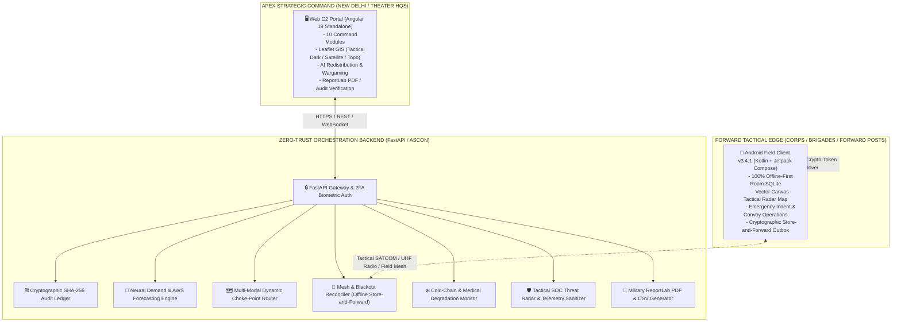

# 🇮🇳 SenaAapurti (सेना आपूर्ति)
### Autonomous Military Logistics, Strategic Predictive Sustenance & Zero-Trust Tactical Command Ecosystem

[](https://sih.gov.in/)
[](https://angular.dev/)
[](https://fastapi.tiangolo.com/)
[](https://developer.android.com/)
[]()

---

## 📌 1. Executive Summary & Mission Overview

**SenaAapurti (सेना आपूर्ति)** is an advanced, military-grade logistics orchestration, predictive ordnance sustenance, and tactical command ecosystem designed specifically for the **Indian Armed Forces** and the **Ministry of Defence (MoD)**. 

Modern high-altitude and frontier warfare (spanning the **Northern Command** along the LAC in Ladakh/Siachen, the **Western Command** along the plains of Punjab and deserts of Rajasthan, and the **Eastern Command** across Arunachal Pradesh and Sikkim) presents unique logistical challenges:
* **Advance Winter Stocking (AWS) Cutoffs:** Critical mountain passes (e.g., Zojila, Rohtang, Baralacha, Sela Pass) remain snow-locked for 5–7 months annually, necessitating precise 180-day predictive stocking of Class I (Rations), Class III (POL - Petroleum, Oil, Lubricants), and Class V (Ammunition & Munitions).
* **Communication Blackouts & Electronic Warfare (EW):** Enemy jamming, fiber decapitation, and extreme terrain routinely sever satellite and WAN telemetry. Logistics operations must remain 100% mission-capable offline at the forward edge.
* **Complex Multimodal Transit:** Sustaining forward posts requires coordinated transition between broad-gauge military railheads, heavy-vehicle strategic highway convoys, extreme 4x4 mule tracks, and rotary-wing tactical air-drops.
* **Auditability & Anti-Sabotage:** Logistics transactions, emergency indents, and diversion orders must be cryptographically signed, immutable, and tamper-evident against insider threats or electronic spoofing.

**SenaAapurti** solves these challenges through an end-to-end tri-tier platform combining an **Apex Web Command & Control (C2) Portal**, a **Zero-Trust Python FastAPI Orchestration Backend**, and an **Ultra-Resilient Offline-First Android Tactical Field Client**.

---

## 🏗️ 2. High-Level System Architecture



---

## 🌟 3. Ten Core Innovations & Technical Breakthroughs

### 1. Autonomous Predictive AI Demand & Advance Winter Stocking (AWS)
* **High-Altitude Neural Modeling:** Employs Prophet, ARIMA, and Gradient Boosting ensembles trained on historical consumption, troop strength escalations, altitude penalty curves, and severe weather forecasts.
* **AWS Window Calculation:** Accurately projects multi-echelon stock depletion across 30, 90, and 180-day operational horizons, preventing high-altitude starvation or ammunition exhaustion before winter pass closures.

### 2. Multi-Modal Dynamic Route Optimization & Pass Choke-Point Bypassing
* **Dynamic Graph Routing (NetworkX):** Real-time traversal analysis over India's strategic defense corridors (NH-1D Srinagar-Leh, Manali-Leh Axis, DBO Road, Sela Tunnel Axis).
* **Automated Tactical Rerouting:** Automatically detects avalanche warnings, road closures, or adversary interdiction and synthesizes cryptographically authorized bypass corridors with adjusted ETAs.

### 3. Blind-Drop Tactical Handover & QR Crypto-Token Manifest
* **Zero-Contact Resupply:** Solves the vulnerable "last-mile" handover in contested or forward areas where vehicles cannot linger.
* **Air-Gapped Cryptographic Handover:** Generates dynamic, time-bounded, SHA-256 encrypted QR manifests. Forward units scan and claim supply caches with zero radio emissions (EMCON compliance).

### 4. Tactical SOC Threat Radar & Telemetry Sanitization
* **Anti-Spoofing & Anomaly Detection:** Real-time scrutiny of convoy GPS telemetry, fuel consumption patterns, and RFID scans.
* **Sanitization:** Flags and isolates telemetric tampering, ghost vehicle insertions, or replay attacks before data enters the national logistics ledger.

### 5. Mesh Resilience & Blackout Reconciler (Offline-First Sync)
* **Store-and-Forward Protocol:** Forward echelon devices queue transactions in local encrypted SQLite/Room storage during complete comms blackouts.
* **Conflict-Free Rebalancing:** Once tactical SATCOM, VHF radio, or field Wi-Fi bursts are detected, data is seamlessly reconciled and recorded into the master PostgreSQL ledger without duplicate indents or race conditions.

### 6. Cold-Chain Degradation & High-Altitude Medical Preservation Engine
* **Biological & Blood Reserve Monitoring:** Mathematical model calculating thermal decay of temperature-sensitive medical supplies, vaccines, and whole-blood reserves across sub-zero Ladakh and high-temperature desert sectors.
* **Automated Expiry Prediction:** Alerts commanding medical officers before supplies degrade past therapeutic thresholds.

### 7. Interactive Military Leaflet GIS Map with 4 Zero-Auth Basemaps
* **Zero External API Keys:** Eliminates third-party service vulnerabilities and map watermarks.
* **Four Distinct Military Basemaps:**
  1. **Tactical Dark (`dark`):** High-contrast military night HUD utilizing inverted OpenStreetMap tiles with glowing amber/cyan highway corridors, international frontiers, and strategic command star markers.
  2. **Satellite (`imagery`):** High-resolution Esri World Imagery Earth Observation for inspecting mountain valleys, passes, and physical geography.
  3. **Dark Canvas (`dark_canvas`):** Minimalist slate-gray cartography for clean strategic situational awareness.
  4. **Topographic (`topo`):** Rich mountain relief and elevation contours essential for artillery and convoy route planning.
* **Dynamic Layers:** Toggleable overlays for Strategic Routes, Real-Time Convoys, Extreme Weather Risks, and Avalanche Hazard Zones.
* **Resilient Tab Lifecycle:** Seamlessly handles Angular DOM detachment without memory leaks or blank container states.

### 8. Native 100% Offline-First Android Tactical Field Client (v3.4.1)
* **Zero Network Dependency:** Built using Kotlin and Jetpack Compose; operates completely air-gapped on ruggedized tactical tablets/smartphones.
* **Native Vector Canvas Map:** High-performance, pinch-to-zoom vector radar map rendered directly on an Android Canvas with coordinate transformations—rendering defense commands, forward posts, and convoys without internet tiles or Google Play Services.
* **Forward Operations Suite:** Emergency Indent Generator (Class I, III, V, VIII), Convoy Waypoint Check-Ins, Days-of-Supply (DOS) metrics, and local tamper-evident Outbox Ledger.

### 9. Classified Military ReportLab PDF & CSV Verification Engine
* **Classified Formatting:** Generates MoD-compliant logistics intelligence reports complete with red classified header stamps (`TOP SECRET // SENA AAPURTI LOGISTICS LEDGER`), dynamic QR codes, audit clearance seals, and confidentiality disclaimers.
* **Cryptographic Ledger Block:** Each generated PDF and CSV report embeds the exact cryptographic transaction hash (`0x7F8C...`), block height, and timestamp from the master database.

### 10. Multi-Scenario Crisis & Wargame Simulation Engine
* **Operational Stress-Testing:** Simulates extreme scenarios including two-front mobilization, winter road collapses, fuel depot drone strikes, and rail disruptions.
* **AI Action Recommendations:** Calculates immediate depot reallocations, emergency air-drop sorties, and national reserve rebalancing directives.

---

## 💻 4. Repository Structure & Subsystems

```text
SenaAapurti/
│
├── SIH26251-SenaAapurti/             # 🖥️ Tier 1: Web Command & Control (C2) Portal
│   ├── src/
│   │   ├── app/
│   │   │   ├── components/           # Navigation, header dossiers, modals
│   │   │   ├── data/                 # Master Indian Army Command & 1,420+ Unit DB
│   │   │   ├── pages/
│   │   │   │   └── command-dashboard/# 10 Command Modules (Leaflet, Wargaming, PDF)
│   │   │   ├── services/             # Logistics, Auth, Language, Theme, Unit services
│   │   │   └── app.routes.ts         # Route table & deep-link parameters
│   │   └── index.html                # Leaflet & ASCON font loaders
│   ├── angular.json                  # Angular CLI build configuration
│   └── package.json                  # Frontend dependencies
│
├── backend/                          # 🔒 Tier 2: Zero-Trust Orchestrator & Ledger
│   ├── app/
│   │   ├── api/                      # FastAPI routers (v1 endpoints)
│   │   │   ├── routes_command.py     # Command dashboard & crisis wargaming
│   │   │   ├── routes_forecast.py    # Predictive demand & AWS curves
│   │   │   ├── routes_handover.py    # Blind-drop QR crypto-token manifests
│   │   │   ├── routes_inventory.py   # Ordnance depots & stock ledger
│   │   │   ├── routes_security_soc.py# SOC threat radar & anomaly detection
│   │   │   └── routes_telemetry.py   # Convoy tracking & tactical reroutes
│   │   ├── core/                     # JWT security, encryption, settings
│   │   ├── mesh_engine/              # Offline buffer & mesh reconciliation
│   │   ├── simulator/                # Adversary attacks, blackout sync demos
│   │   ├── soc_engine/               # Incident ledger & radar analytics
│   │   ├── spatial_engine/           # Dynamic routing & terrain weather feeds
│   │   └── main.py                   # Application factory & CORS gateway
│   ├── requirements.txt              # Python dependencies (FastAPI, ReportLab, etc.)
│   └── docker-compose.yml            # PostgreSQL & backend containerization
│
└── android-field-client/             # 📱 Tier 3: Android Tactical Field Client
    ├── app/src/main/
    │   ├── java/gov/senaaapurti/fieldclient/
    │   │   ├── data/local/           # Room Database, DAOs, Entities, Seed Data
    │   │   ├── repository/           # Operations & Offline Sync Repositories
    │   │   └── ui/
    │   │       ├── navigation/       # Jetpack Compose Navigation
    │   │       └── screens/          # Dashboard, Tactical Canvas Map, Operations, Outbox
    │   └── AndroidManifest.xml       # Permissions (Fine location, network state)
    ├── build.gradle.kts              # Gradle build script (SDK 35, Java 17)
    └── SenaAapurti-FieldClient-v3.4.1.apk # Ready-to-deploy tactical field APK
```

---

## 📊 5. Indian Army Theater Command Coverage

The system models and provides real-time logistics command across all **7 Apex Commands of the Indian Army**:

| Command Code | Command Name | Strategic Headquarters | Primary Operational Focus |
| :--- | :--- | :--- | :--- |
| **NC** | Northern Command | Udhampur, J&K | High-Altitude Warfare, LAC (Ladakh), LoC (Kashmir, Siachen) |
| **WC** | Western Command | Chandimandir, Haryana | Plains & Riverine Warfare (Punjab, Jammu Borders) |
| **EC** | Eastern Command | Kolkata, West Bengal | Dense Jungle & High-Altitude Frontier (Sikkim, Arunachal LAC) |
| **SWC** | South Western Command | Jaipur, Rajasthan | Desert Warfare & Mechanized Strike Corridors |
| **SC** | Southern Command | Pune, Maharashtra | Amphibious Logistics, Peninsular Security & Rann of Kutch |
| **CC** | Central Command | Lucknow, Uttar Pradesh | Strategic Echelon Reserves & Central Sector (Uttarakhand) |
| **ARTRAC** | Army Training Command | Shimla, Himachal Pradesh | Doctrine, Logistics War-Gaming & Tactical Simulation |

---

## 🚀 6. Step-by-Step Installation & Local Execution

### Prerequisites
* **Node.js**: `v18.x` or `v20.x` LTS
* **Python**: `3.11+`
* **Java JDK**: `17` (for Android build)
* **Android SDK**: Build-Tools `35.0.0`
* **Git**: Installed and configured

---

### Step 1: Clone the Repository
```bash
git clone https://github.com/abtshriya/SIH26251-SenaAapurti.git
cd SIH26251-SenaAapurti
```

---

### Step 2: Run the Web Command & Control Portal
```bash
# Navigate to web frontend directory
cd SIH26251-SenaAapurti

# Install Node dependencies
npm install

# Start the Angular development server
npx ng serve --open
```
* **URL:** `http://localhost:4200/`
* **Default Route:** `/command/dashboard`
* **Features Available Immediately:** Full 10-module C2 Dashboard, Interactive Leaflet GIS Map with 4 basemaps, Unit Directory, AI Forecasting, Real-Time Convoys, Wargame Simulator, and Instant Classified PDF/CSV Exports.

---

### Step 3: Run the Zero-Trust FastAPI Backend
```bash
# Open a new terminal and navigate to backend directory
cd backend

# Create and activate Python virtual environment
python -m venv .venv

# On Windows:
.venv\Scripts\activate
# On Linux / macOS:
# source .venv/bin/activate

# Install dependencies
pip install -r requirements.txt

# Start FastAPI server
uvicorn app.main:app --host 0.0.0.0 --port 8000 --reload
```
* **API Documentation (Swagger UI):** `http://localhost:8000/docs`
* **Alternative Redoc:** `http://localhost:8000/redoc`
* **Health Check Endpoint:** `http://localhost:8000/health`

---

### Step 4: Run or Install the Android Tactical Field Client

#### Option A: Install Pre-Built Signed APK
The production APK is pre-compiled and included in the workspace root:
```bash
# Install directly onto connected Android phone, tablet, or emulator via ADB:
adb install D:\SenaAapurti\SenaAapurti-FieldClient-v3.4.1.apk
```

#### Option B: Build from Source
```bash
# Navigate to android client directory
cd android-field-client

# On Windows:
.\gradlew.bat assembleDebug

# On Linux / macOS:
# ./gradlew assembleDebug
```
The output APK will be generated at:
`android-field-client/app/build/outputs/apk/debug/app-debug.apk`

---

## 🔒 7. Security, Zero Trust & Compliance

* **Zero-Trust Network Architecture (ZTNA):** Every inter-module API request requires scoped JWT tokens, biometric step-up authentication headers (`X-StepUp-Token`), and cryptographic request tracking (`X-Request-ID`).
* **Cryptographic Transaction Ledger:** High-impact operations (convoy reroutes, emergency ammunition releases, high-value depot transfers) produce a SHA-256 block hash recorded in an append-only ledger.
* **EMCON (Emission Control) Compliance:** The Android Field Client can be deployed in complete Radio Silence / Airplane Mode. No analytics, tracking SDKs, or background telemetric beacons exist.
* **Air-Gap Readiness:** Both frontend and backend can be hosted entirely on isolated local military intranets (e.g., ASCON - Army Static Switched Communication Network).

---

## 📄 8. Testing & Quality Assurance

```bash
# Run Frontend Type-Check & Lints
cd SIH26251-SenaAapurti
npx tsc --noEmit

# Run Backend Unit Tests
cd backend
pytest -v

# Run Android Lint & Unit Tests
cd android-field-client
./gradlew test
```

---

## 🎖️ 9. Smart India Hackathon (SIH) Information

* **Organization:** Ministry of Defence (MoD) / Indian Army
* **Project Title:** SenaAapurti (सेना आपूर्ति)
* **Focus Category:** Software / AI-Powered Military Logistics & Tactical Defense Preparedness
* **License:** Restricted / Proprietary Defence Research Prototype
